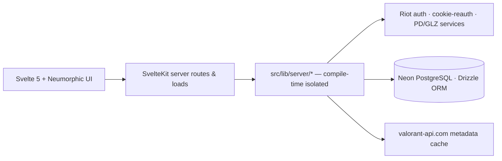

# geim

**A private, neumorphic dashboard for your game accounts.** See your daily shop, what your skins are worth, and how your matches are going — all in one place.

Built for **VALORANT** first, designed so other games can plug in later without a rewrite.

[](https://kit.svelte.dev)
[-FF3E00?logo=svelte&logoColor=white>)](https://svelte.dev)
[](https://bun.sh)
[](https://orm.drizzle.team)
[](https://neon.tech)
[](https://tailwindcss.com)
[](https://www.typescriptlang.org)

<!-- TODO: add a screenshot or demo GIF here -->

## Features

- **Shop** — daily offers and Night Market with exact expiry countdowns, plus live wallet balances.
- **Inventory** — owned weapon skins, variants/levels, buddies, sprays, cards, titles, and current equipped loadout. Read-only by design.
- **Valuation** — estimated purchase value of your collection in VP and real currency (IDR, USD, extensible), with explicit pack/FX provenance and per-item price coverage.
- **Tracker** — match history and details, rank/RR, and performance summaries over explicit sample sizes.
- **Accounts** — register with a geim username and password. Riot connections and saved syncs are private to each user.
- **Shared profiles** — confirm before publishing a read-only collection, valuation, rank, and aggregate stats. Shared pages open on Collection, with Stats second; individual matches and scoreboards are never exposed. Each Riot account gets one random, persistent link; share again to publish a newer saved sync at the same URL. Visitors never trigger a Riot refresh. Wallet balances and credentials are excluded.
- **Privacy-first** — self-hostable. Riot session material is encrypted at rest and never leaves the server side.

## Tech stack

| Layer     | Choice                                                                                |
| --------- | ------------------------------------------------------------------------------------- |
| Framework | SvelteKit 3 · Svelte 5 runes · TypeScript                                             |
| Runtime   | Bun (`bun.lock`)                                                                      |
| Hosting   | Vercel Free Tier (`@sveltejs/adapter-vercel`, `sin1` region)                          |
| Database  | Neon Serverless PostgreSQL over HTTP + Drizzle ORM                                    |
| Styling   | Tailwind CSS v4 + custom Neumorphism (Soft UI) system + `@lucide/svelte`              |
| Security  | `zod` upstream contracts · `AES-256-GCM` session encryption · server-only Riot access |

## Architecture



All Riot access lives inside `src/lib/server/`, which SvelteKit keeps out of browser bundles at compile time. Responses to the browser never contain Riot cookies, passwords, tokens, or raw auth payloads.

## Getting started

### Prerequisites

- [Bun](https://bun.sh) v1.x
- A [Neon](https://neon.tech) PostgreSQL database (free tier works)

### Setup

```bash
# 1. Install dependencies
bun install

# 2. Configure environment
cp .env.example .env
#    Fill in DATABASE_URL and generate a master key:
bun -e "console.log(crypto.randomBytes(32).toString('hex'))"

# 3. Push the schema
bun run db:push

# 4. Run the dev server
bun run dev
```

Register at `/register`, then connect your Riot account from the dashboard. Existing
single-owner vaults keep their accounts and password; sign in using the username `owner`.
Usernames are case-insensitive and allow 3-32 letters, numbers, or underscores.

For an existing database, apply `scripts/add-shared-profiles.sql` once (or run
`bun run db:push` and review its proposed changes). The SQL only adds the sharing table.
Shared pages remain frozen until the owner confirms another publish. Disconnecting a
Riot account also removes its share link. Links are accessible without login, so only
share them with people who should see the published data.

### Verify Riot connectivity (Milestone 0)

The interactive VALORANT spike exercises real auth flows — OAuth redirect URL, `ssid` cookie renewal, or direct login/MFA — without logging secrets:

```bash
bun run spike:valorant
```

## Scripts

| Command                              | What it does                                     |
| ------------------------------------ | ------------------------------------------------ |
| `bun run dev`                        | Dev server                                       |
| `bun run build`                      | Production build                                 |
| `bun run check`                      | `svelte-kit sync` + `svelte-check` typecheck     |
| `bun run test`                       | Vitest unit suite (crypto, redaction, valuation) |
| `bun run lint`                       | Prettier + ESLint                                |
| `bun run db:push`                    | Push Drizzle schema to Neon                      |
| `bun run db:generate` / `db:migrate` | Generate and run migrations                      |
| `bun run db:studio`                  | Drizzle Studio DB browser                        |
| `bun run spike:valorant`             | Interactive Riot auth verification harness       |

For an existing database created before migrations were tracked, run
`bun run scripts/baseline-migrations.ts` to verify it against the first two migration
snapshots. Only if it matches, run the same command with `--apply` to record those
migrations, then use `bun run db:migrate` normally. Do not use the baseline command
for a fresh database or one with an existing migration journal.

## Project structure

```text
src/
├── lib/
│   ├── components/          # Neumorphic UI (shop, inventory, tracker, inspector modal)
│   └── server/              # Server-only — never bundled to the browser
│       ├── auth/            # Username/password accounts & sessions
│       ├── crypto/          # AES-256-GCM seal + secret redaction
│       ├── db/              # Drizzle schema & queries
│       ├── providers/valorant/  # Riot client, zod schemas, tracker, skin catalog
│       └── valuation/       # VP pricing, pack profiles, FX conversion
├── routes/                  # Dashboard, login, register, public shared profiles, media proxy
scripts/spike-valorant.ts    # Milestone 0 auth spike
```

## Project status

Initialized 2026-10-26. Scaffolded so far: app workspace, Drizzle schema foundation, `AES-256-GCM` session crypto, VALORANT zod parsers, neumorphic UI shell, and the Milestone 0 CLI spike. **Live Riot verification is the current milestone.**

## Security & legal

> [!WARNING]
> This project uses **unofficial Riot endpoints**. Official RSO access does not expose personal storefront data, and Riot lists online-store tracking as an unapproved use case. Use at your own risk, with accounts you own.

- Never commit credentials, Riot cookies/tokens, unredacted API responses, or private account data.
- CAPTCHA / Cloudflare challenges are treated as a _blocked_ login state — no bypasses, ever.
- This is a fan-made project. Not affiliated with, endorsed, or approved by Riot Games. VALORANT and Riot Games are trademarks of Riot Games, Inc.

## Contributing

Early stage — the architecture and conventions are still settling. If you want to help:

1. Open an issue before starting on anything non-trivial.
2. Keep Riot-specific logic inside `src/lib/server/providers/` and never leak secrets to the client.

## License

No license chosen yet — see [choosealicense.com](https://choosealicense.com) (MIT or AGPL are the usual candidates for a project like this). A `LICENSE` file is coming before any public release.
